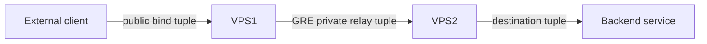

# Architecture and operating boundaries

The CLI treats a GRE tunnel and its forwarding entries as separate resources. Each server stores a local version-1 JSON state with `tunnels` and `forwards` keyed by stable names. Desired runtime flags are distinct from live observations. Monitoring always reads the kernel or service manager and performs reachability probes.

## Modules

| Module | Responsibility |
| --- | --- |
| `models.py` | Normalize records, validate names/addresses/ranges, reserve ports and detect managed conflicts. |
| `pairing.py` | Bounded checksummed exchange, side reversal, peer matching and revision checks. |
| `render.py` | Pure systemd, rathole and nftables rendering with explicit ownership markers. |
| `host.py` | Shell-free command execution, kernel/socket/service observations and health diagnostics. |
| `store.py` | Private atomic persistence, symlink rejection and exclusive mutation lock. |
| `engine.py` | Preview, snapshots, safe application, read-back verification, journaled rollback and recovery. |
| `cli.py`, `menu.py` | Scriptable commands, JSON output, confirmations and guided interactive menu. |

## Lifecycle transaction

Every mutation follows validate → preview → apply → verify → commit. Preview is the default and contains the desired configuration, commands, changed generated files, expected checks and rollback actions. Secrets are redacted. `--apply` requests execution; `--yes` supplies noninteractive confirmation.

The engine checks ownership, saves prior generated files and modes, managed kernel link parameters/addresses, unit active/enablement state, the owned nftables table and the IP-forwarding value. A private on-disk journal is written before network changes. A root-owned global host lock plus a private state-directory lock serialize this process. Verification reads applied resources back before the candidate state is committed atomically. A failed application invokes rollback; a failed or interrupted rollback leaves a journal and concrete recovery instructions. Subsequent mutations must not skip this journal.

The transaction is local. No SSH automation reaches the peer, and no two-host distributed transaction is implied. After shared forwarding changes the operator transfers and imports a new private export. Forward revision and peer revision expose configuration synchronization intent; external traffic testing is still needed to prove the pair works.

## Resource ownership

Interfaces use deterministic `tl` plus a hash, bounded by Linux's 15-byte name limit. The actual interface must be GRE and carry alias `twinlink:NAME` before it can be changed or deleted. An arbitrary physical or foreign interface with the same name must be rejected.

Generated files carry `# twinlink-owned`. Units use `twinlink-gre-NAME.service`, `twinlink-rathole-NAME.service`, and `twinlink-restore.service`. The engine refuses to replace a foreign file. Runtime paths are absolute and arguments are passed directly to subprocesses rather than interpreted by a shell.

All managed firewall rules live in the dedicated IPv4 `ip twinlink` nftables table. A table with that name must have the ownership comment before replacement is permitted. Changes use an nftables validation pass and an atomic table transaction. No global ruleset flush or replacement of unrelated tables occurs. The table's read-back fingerprint excludes counters and handles but retains rule expressions and order, so harmless counter increments do not masquerade as drift.

Unrelated host filter rules remain authoritative. An existing INPUT or FORWARD policy can still block GRE or forwarded traffic. Operators must configure that policy deliberately; creating an application-owned table does not authorize weakening unrelated firewall policy. GRE tunnel routes are confined to the private point-to-point subnet; default routes and physical interface addresses are not rewritten.

Stopping/deleting a kernel entry also expires its matching conntrack tuple. Removing DNAT rules alone would leave established connections using the old translation. Foreign listener ownership is never inferred just from an overlapping port.

## Packet paths

Kernel mode applies DNAT on VPS1 to the peer GRE address and a per-entry relay port/range, then DNAT on VPS2 to its reachable backend. Return traffic uses managed SNAT/masquerade. MTU is configured per GRE tunnel and inspected with path-MTU diagnostics. Relay ranges reserve a maximum of 256 ports and remain reserved by stopped/disabled records. A singleton backend port maps a whole public range to that port; otherwise range widths must agree. IPv4 forwarding is enabled when required and its previous value is captured for transaction rollback.

Rathole mode uses one service and strong token per entry. VPS1 listens for the rathole connection only on its private GRE address and separately binds the chosen public service tuple. VPS2 connects to that private GRE address and opens the destination connection locally. Its service identity, token and transport port must match VPS1. Generated TOML is private. TCP is supported; UDP is rejected pending version-specific packet tests. Neither mode supplies GRE encryption.

## Pairing and secrets

GRE codes start `v1.`. Forward codes start `f1.`. The frame contains a CRC32 over canonical JSON followed by gzip-compressed JSON, encoded as base64url. Decoding accepts outer clipboard whitespace and padding but rejects unknown versions/kinds, duplicate JSON fields, malformed data and failed checksums. Encoded input is bounded to 128 KiB and decompressed JSON to 64 KiB. CRC32 detects corruption, not malicious tampering or identity.

GRE export whitelists the tunnel's name, side, public endpoints, both private addresses, key, MTU and TTL. It excludes forwarding credentials. Import swaps both endpoint/address pairs and side, regenerates the local interface name, and returns an unverified, stopped record. The CLI previews this decoded record with active runtime and boot flags before applying the import; verification remains false. Conflicts are validated before any application.

Forward export explicitly includes a rathole token when applicable and must be written to a private mode-0600 file. Import matches the mirrored tunnel by endpoints, private addresses, key, MTU and TTL rather than a host-local tunnel name. A verified matching GRE tunnel is required. The canonical public bind remains VPS1's address on either host. Service name changes for rathole are refused because they would prevent server/client matching. Older revisions are rejected. Imports are stopped until explicitly started.

State, journals and rathole configurations contain secrets and require restricted permissions. Preserve them only in private backups. Human-readable previews and routine JSON responses redact tokens; explicit forwarding export is the intentional secret transfer boundary.

## Health and proof

GRE health comes from private-address probes with measured packet loss and latency, plus kernel parameters and address drift. Tunnel UP alone does not establish reachability. Forward health adds mode-specific checks for the rathole process/connection, public listener or installed kernel rules, and destination reachability. Checks distinguish a failed tunnel from a failed destination. Missing permissions or unavailable observation tools produce uncertainty rather than invented success.

Unit tests prove model and transaction behavior under controlled inputs. Namespace integration tests prove packet paths on the tested Linux/rathole versions. Real two-server tests additionally establish provider protocol-47 behavior, host firewall compatibility, path MTU, external request delivery and recovery after actual reboot. These are different evidence levels and should be reported separately.

## Installation and removal

The source installer uses OS packages for network tools and creates a dependency-free Python zipapp. `/usr/local/bin/twinlink` is a launcher; `/usr/local/libexec/twinlink-runtime` remains available to managed units even after program-only removal. Installation manifests record exact owned paths and SHA256 hashes and prevent replacing or removing modified/foreign files.

Program-only uninstall removes the launcher but retains the runtime when managed records or owned units remain. Full purge first runs the same transactional managed-resource deletion with explicit cascade authorization. Runtime removal is permitted only after successful empty state and removal of owned units. State/backups and external packages/rathole remain for operator review. An incomplete transaction must be recovered before either removal flow proceeds.
